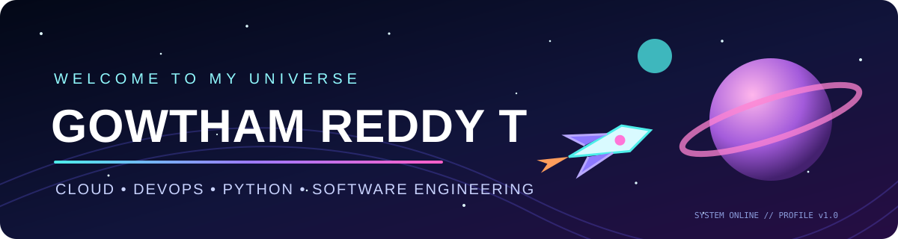

# 👨‍🚀 GOWTHAM REDDY T

### Cloud • DevOps • Python • Software Engineering

*Exploring the universe of technology, one deployment at a time.*

---

## 🪐 About Me

- 🎓 B.Tech in Computer Science and Engineering — Cloud Technology & Information Security (2025)
- ☁️ Interested in Cloud Computing, DevOps, and Backend Development
- 🛠️ Working with Python, Django, AWS, Docker, Jenkins, and CI/CD
- 🚀 Building and learning through hands-on projects

## 🛰️ Tech Stack

## 🌌 NEXUS: CODE GALAXY

**Every contribution fuels the universe. Every commit moves the mission forward.**

*“Keep exploring. Keep building. Keep launching.”* 🚀

